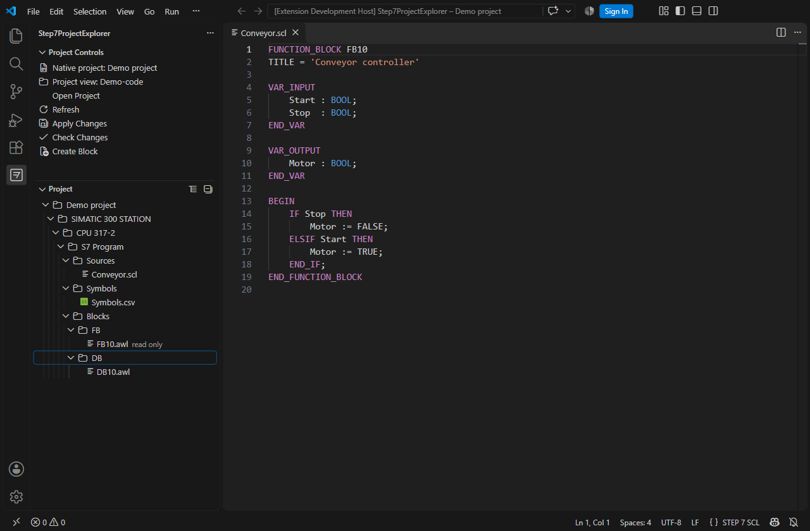

# Step7ProjectExplorer

**English** | [Русский](README.ru.md)

[](https://github.com/Svyatogor3757/vscode-step7-project-explorer/releases/latest)
[](LICENSE)


[Quick start](#quick-start) · [Agent guide](docs/AGENT-USAGE.md) · [Releases](https://github.com/Svyatogor3757/vscode-step7-project-explorer/releases) · [Report a bug](https://github.com/Svyatogor3757/vscode-step7-project-explorer/issues)

Step7ProjectExplorer is a **VS Code extension for editing STEP 7 Classic project code**. Sources, blocks and symbols share one workspace: search code and references, edit multiple files and compare changes with Git.

The extension creates an **editable view of the original project** – a directory of UTF-8 files for ordinary editing tools. Changes are checked on a temporary copy and written to the original through a separate Apply Changes command.

These files also let **AI agents study, review, create and refine code**. Give Codex a file path; changes are checked through the CLI following the instructions in AGENTS.md.

Supports **Sources, Symbols and Blocks** for **STEP 7 V5.5 SP3 / S7-300 on Windows**, including **VS Code Remote SSH**. Some objects are read-only. Hardware, networks, connections and PLC downloads remain in Siemens' standard applications.



Project tree and SCL editor with a demonstration project.

## Quick start

Download a VSIX from [GitHub Releases](https://github.com/Svyatogor3757/vscode-step7-project-explorer/releases), install it using **Extensions → … → Install from VSIX**, then open **Step7ProjectExplorer**. The local 0.1.5 package is `releases/step7project-0.1.5.vsix`. Original code is MIT; dependencies retain their [own licenses and review notes](THIRD-PARTY-NOTICES.md). After updating an installation, run **Developer: Reload Window**.

1. In **Project Controls**, choose **Open Project** and select the original STEP 7 project file, for example `D:\PLC\Plant\Plant.s7p`.
2. In the next dialog, select the **folder in which to store the project view**. The extension creates `<project-name>-code` inside it. For example, selecting `D:\Code` creates `D:\Code\Plant-code`. This is the editable view directory, separate from the original project.
3. Open a file under **Sources**, **Symbols** or **Blocks**, edit it and save. Read-only objects remain available for inspection.
4. Run **Check Changes** to compile the edits on a temporary copy. Review the result, then use **Apply Changes** to write them back to the original STEP 7 project. Saving a view file alone does not write the original project.

To reconnect an existing view, choose its `step7project.json` instead of creating another export. Views inside open workspace folders are also detected automatically. Native import and compilation require a licensed STEP 7 installation with the relevant language packages; offline reading does not.

## Features

| Task | Available actions |
| --- | --- |
| Browse a project | View Sources, Symbols and Blocks for each CPU/program; switch between multiple connected views. |
| Edit code and data | Edit supported SCL/AWL sources and writable AWL representations of blocks, DBs and UDTs. Unsupported or protected objects stay read-only. |
| Create and remove objects | Create OB/FC/FB/DB/UDT source templates, including instance DBs; rename Sources objects and explicitly mark sources or blocks for deletion. |
| Work with symbols | Use the built-in table, a text editor or a third-party CSV editor. Switch the canonical table between CSV and ASC. |
| Review changes | Show a diff against the exported baseline, check compilation on a copy, then apply with conflict detection and re-export verification. |
| Refresh from STEP 7 | Reread the native project while preserving local edits and reporting conflicts. |
| Keep backups | Choose a backup schedule, inspect previous file versions, and restore a snapshot into a new directory. |
| Work with an AI agent | Use real file paths, generated instructions and CLI commands for status, checks, creation, rename, deletion and Apply. |
| Reopen or move a view | Open step7project.json, reuse known views and store relative native-project paths when possible. |
| Choose a language | Follow the VS Code language, select English/Russian, or import a partial personal translation with English fallback. The Step7ProjectExplorer name stays English. |
| Use Remote SSH | Run the extension and backend on the Windows host containing STEP 7 and the project. |


## Explorer, active projects and portability

The sidebar uses two standard VS Code views, **Project Controls** and **Project**, like Outline and Timeline. Project Controls exposes five actions as individual rows: open, refresh, apply, check and create a block. Views can be collapsed and resized; actions remain accessible in a narrow sidebar.

If controls are hidden, use **Show Project Controls** from the command palette or the project tree toolbar. It reveals the view without resetting other panels. Refresh rereads the STEP 7 project; after installing an extension update, use Reload Window. See [VS Code extension updates](https://code.visualstudio.com/docs/configure/extensions/extension-marketplace#_update-an-extension).

English and Russian are bundled. The default interface language follows VS Code's Display Language. `step7project.interface.language` can override the language of the tree and dialogs. **Choose Interface Language** can import personal `interface_*.json` translations without rebuilding and lists previously imported files. Missing translations fall back to standard English. Native VS Code commands, container names and settings follow the editor's Display Language; reopen an existing Symbols editor after changing the extension language. CLI, backend and compiler diagnostics may remain in their original language. The interface language does not change AWL mnemonics. See the [translation format and example](language/README.md).

Settings dropdowns show translated labels such as “Every save”, “Table” and “Relative when possible”. Stored JSON values remain `everySave`, `table` and `relative`, preserving existing configuration.

Automatic selection considers both bundled and saved personal translations. If the detected editor locale has no matching language, English is used. An explicit user selection takes precedence over automatic detection.

When a workspace opens, the extension searches its roots and nested directories for `step7project.json`. Backup and internal directories such as `.git`, `.step7project`, `.scratch` and `node_modules` are excluded. Multiple project views are supported. **Select Active Project**, opening one of its files, or selecting a file in the tree changes the active project. Control actions target that project; its selection is remembered for the workspace.

Project Controls shows the native project and its project view, with full paths in tooltips. Clicking either opens VS Code's Files Explorer. An existing containing workspace folder is reused, choosing the most specific root when several match. Otherwise, the appropriate native-project or project-view directory is added to the current workspace while preserving other roots. A missing path reports an error. Context actions copy absolute or relative paths and open Windows Explorer; the project view also has an explicit VS Code Explorer action.

Removing a workspace folder closes a project connection when no remaining root contains its view. Files are retained. To reconnect, select `step7project.json` through Open Project. Closed projects are not reopened automatically. Temporary navigation state only completes a folder addition already requested before an Extension Host restart; cancelled additions and subsequently removed folders stay closed.

The manifest's `project` field points to the native `.s7p`. Relative values resolve **from the manifest directory**, independently of the terminal's current directory. New views default to `step7project.projectPath.mode: relative`; different drives require an absolute path. Native projects and their views can therefore move together while preserving their relative layout. The view's own path is not duplicated in the manifest.

Existing absolute references are preserved. To change an existing view, use `step7project.cmd configure --workspace . --project-path relative` or `absolute`. This preserves the native project and local edits. New views and relative-path migration use schema 2; extension 0.1.0 rejects this schema instead of resolving paths incorrectly. Legacy schema 1 is supported.

The native-project-to-view index lives only in the extension's user state on its host, outside Siemens projects and Git. The manifest is checked before reconnecting. After transfer, open the view directory or its JSON manifest; its generated launcher is rebound to the current extension installation. Custom launchers and existing AGENTS.md files are preserved.

Offline project reading does not require STEP 7. Import and compilation require a licensed STEP 7 installation with the relevant language packages, .NET Framework 4.8, and a project previously opened in SIMATIC Manager. VS Code must run as a user who can access the project. Hardware configuration, NetPro and PLC downloads remain Siemens operations.

## Remote SSH

Connect VS Code Remote SSH to the Windows machine with STEP 7 and install this extension **on the remote host**. Projects and editable files remain there. For native writes, sign in to Windows as the same account: STEP 7 compilers require an interactive desktop session. The bridge uses a temporary scheduled task to run in that session; no password is stored in extension settings. Offline reading and text editing work without a desktop session.

The extension declares `extensionKind: workspace`, so the backend runs on the same host as the project view. See the [Remote Extensions model](https://code.visualstudio.com/api/advanced-topics/remote-extensions).

## Editing support

| Object | Representation and write support |
| --- | --- |
| SCL and AWL/STL Sources | Original source text; import and compilation through STEP 7 |
| AWL OB, FC and FB | Full AWL export and recompilation when unprotected |
| DB and UDT | AWL representation of structure and values, followed by recompilation |
| Blocks compiled from SCL | Available representation is read-only; edit the original Sources object |
| LAD/FBD/GRAPH and unknown formats | Read-only; graphical originals are not automatically converted to AWL |
| Protected blocks and SFC/SFB | Read-only metadata/interface where available; protection is preserved |
| Symbols | CSV or ASC, using the built-in table, a text editor or a third-party CSV editor |
| VAT | Shown as blocks unsupported for editing; VAT references in Symbols are preserved |

**Create Block** creates OB/FC/FB/DB/UDT source templates in SCL or AWL, including instance DBs. They remain local source files until Apply compiles them into native blocks. STEP 7 performs final checks of block numbers and dependencies.

A source can produce multiple blocks. Deleting a source leaves its compiled blocks; delete those explicitly under Blocks if required. A missing local file does not automatically delete a native object. **Rename Source** changes the Sources object name, with a 1–24 character limit, Windows-name validation and duplicate checks within its program. It does not rename functions inside the source. The rename remains pending until Apply reimports and compiles it through STEP 7, with staging and re-export verification; Siemens updates the native tables.

Function identifiers and references inside source text are not renamed automatically. Renaming `DB117.awl` as a file does not migrate a block number. A symbolic block name is a Symbols entry with an address such as `DB117`; changing the number requires creating a new block, migrating references, checking consistency and explicitly removing the old block. Global reference migration is not implemented.

`step7project.awl.mnemonics` selects English (`A`, `JU`) or German (`U`, `SPA`) mnemonics for new project views. Match **STEP 7 → Options → Customize → Language**. The dialect is stored in the manifest. For an existing clean view, run `configure --workspace . --mnemonics english` or `german`, then `refresh --workspace .`. Existing text is not translated automatically. A separate CSL compiler is not implemented; supported source languages are SCL and AWL/STL.

Unprotected user blocks, including those compiled from SCL, can be explicitly deleted. Deletion support does not imply text-editing support. Changing an FB/UDT interface may require updating dependent blocks and instance DBs. Dependencies are not all regenerated automatically; verify consistency in STEP 7.

## Symbols and backups

`step7project.symbols.editor` selects `table` for the built-in table, `text` for the text editor, or `default` for the default editor, including third-party CSV extensions. **Open as Text** is also available in the context menu.

`step7project.symbols.format` selects CSV or ASC for new views. New files are named `Symbols.csv` or `Symbols.asc` inside Symbols. For existing views, use **Choose Symbols Format** with no pending table edits. Legacy `Symbols.symbols.csv` files remain supported: close Symbols editors and select the current format again to simplify the filename. An existing destination causes the operation to fail instead of overwriting it. There is one canonical symbols file; CSV and ASC are not independently edited in parallel.

`step7project.backup.mode`:

| Value | Schedule |
| --- | --- |
| `off` | Disabled |
| `everySave` | Every observed save; default |
| `1m` | Every minute |
| `10m` | Every 10 minutes |
| `30m` | Every 30 minutes |
| `1h` | Every hour |

Previous file versions are retained, including observed external-tool and AI writes while the extension is active. A filesystem watcher can combine rapid writes; closed VS Code windows do not record external saves. Every enabled mode also snapshots the native project before Apply. Disabled mode creates no persistent automatic backups.

`step7project.backup.directory` defaults to `.step7project/backups` inside the view. Snapshots are not pruned automatically. **Restore Backup to New Folder** restores into a new location, preserving the open project.

CSV/ASC stores symbol, address, type and comment. A native table with additional attributes that cannot survive this format, such as WinCC metadata, is made read-only with the reason exposed in `status`. Incomplete rows can be read; mandatory fields must be completed before Apply. Unknown symbols are not automatically deleted.

## AI agent workflow

Each exported view receives `AGENTS.md` and `step7project.cmd`; existing agent instructions are preserved. Repository instructions are in [AGENTS.md](AGENTS.md), with detailed commands in [docs/AGENT-USAGE.md](docs/AGENT-USAGE.md).

```powershell
.\step7project.cmd status --workspace . --json
.\step7project.cmd check --workspace . --json
.\step7project.cmd apply --workspace . --json
```

The manifest binds files to exact programs and native objects. Baselines and backups live under `.step7project`. Saving text is separate from native import; agents must report check and apply results separately.

## Apply reliability

Before writing, the extension checks the affected program inventory, compiles a COM copy of the program in a separate TEMP project, and checks the original project again. Staging uses native `S7Program.Copy`; binary project tables are not edited directly. Applied objects are re-exported and compared with the staged result.

The native COM API provides no shared transaction across multiple imports. A write failure preserves local edits and sets a durable `recovery` barrier, blocking further Apply operations until operator review. There is no automatic rollback over an open project. States and recovery steps are described in the agent usage guide.

Avoid editing the same program simultaneously in SIMATIC Manager and the extension. The Step7ProjectExplorer lock excludes another instance of this tool; it does not lock Siemens editors. Test projects and logs remain in `%TEMP%` for diagnostics.

## Building and verification

Toolbox source is pinned in the `third-party/sources/Toolbox` Git submodule. Run `git submodule update --init --recursive` for investigation and subsequent source work. See [per-component licenses and nuances](third-party/Toolbox.COMPONENTS.md). Normal backend builds still consume the unmodified NuGet 4.4.10 package.

Requirements: Node.js 20+, npm, and a current .NET SDK capable of building `net48`. NuGet supplies reference assemblies; STEP 7 is not needed for compilation of the extension itself.

```powershell
npm ci
npm run build:backend
npm test
npm run licenses:audit
npm run package
```

Packaging runs `licenses:audit`: technical inventory mismatches fail the build, while open legal review items are reported and retained. `licenses:check` is a separate strict distribution-review command. Creating a local VSIX does not change dependency licenses or resolve those items. See [docs/LICENSING.md](docs/LICENSING.md).

The backend targets **x86** because the STEP 7 V5.x Command Interface is 32-bit; see [Siemens V5.5 SP4 README, Command Interface](https://support.industry.siemens.com/cs/attachments/93842005/README.pdf). The project targets V5.5 SP3, rather than TIA Openness.

Press F5 to launch the Extension Host using `.vscode/launch.json`. VM checks use `node tools/deploy-test.cjs` and `node tools/run-integration.cjs`; they require authorization to access SSH alias `vmware-siemens` and create fresh TEMP projects. Do not run them against a working production project.

Completed checks and limits: [docs/VERIFICATION.md](docs/VERIFICATION.md). Backend architecture and primary references: [docs/BACKEND.md](docs/BACKEND.md). Version history: [CHANGELOG.md](CHANGELOG.md) / [Русский](CHANGELOG.ru.md).

## Repository and releases

`src/` contains the extension and CLI; `backend/` the x86 COM bridge and offline reader; `test/` automated tests; `tools/` verification and VM utilities; `docs/` operational guides. User examples and build outputs are excluded from Git. VSIX packages contain compiled JavaScript, the backend and required notices.

`language/interface_*.json` are translation sources. `releases/` holds local build outputs. `npm run package` creates that directory and writes `step7project-<version>.vsix` there after the required checks.

The root JSON files serve different purposes:

| File | Purpose |
| --- | --- |
| `package.json` | Required extension manifest: commands, settings, build commands and declared dependencies. The language generator updates the bundled-language list and settings labels. |
| `package-lock.json` | Exact npm dependency graph and integrity values for reproducible `npm ci`; distinct from the extension manifest. |
| `package.nls.json`, `package.nls.ru.json` | Generated dictionaries for commands and settings read by VS Code. Edit their sources in `language/`. |

Git tags identify historical source revisions; binaries belong in [GitHub Releases](https://github.com/Svyatogor3757/vscode-step7-project-explorer/releases). See [docs/RELEASING.md](docs/RELEASING.md) for versioning, CI and draft-release handling. Historical release drafts do not imply licensing clearance.

## License

Original Step7ProjectExplorer code is licensed under [MIT](LICENSE). Author: **Cody** ([Svyatogor3757](https://github.com/Svyatogor3757)). Retain the copyright and full license text when distributing copies or substantial portions.

Third-party components retain their licenses and authorship: [THIRD-PARTY-NOTICES.md](THIRD-PARTY-NOTICES.md). Distribution requirements and known nuances are documented in [docs/LICENSING.md](docs/LICENSING.md).

## Disclaimer

Siemens, SIMATIC and STEP 7 are trademarks of Siemens AG or its affiliates. These names are used solely to identify compatibility with their respective products and technologies.

Step7ProjectExplorer is an independent project and is not affiliated with, sponsored by, endorsed by, or officially supported by Siemens AG. All trademark rights remain with their respective owners.
