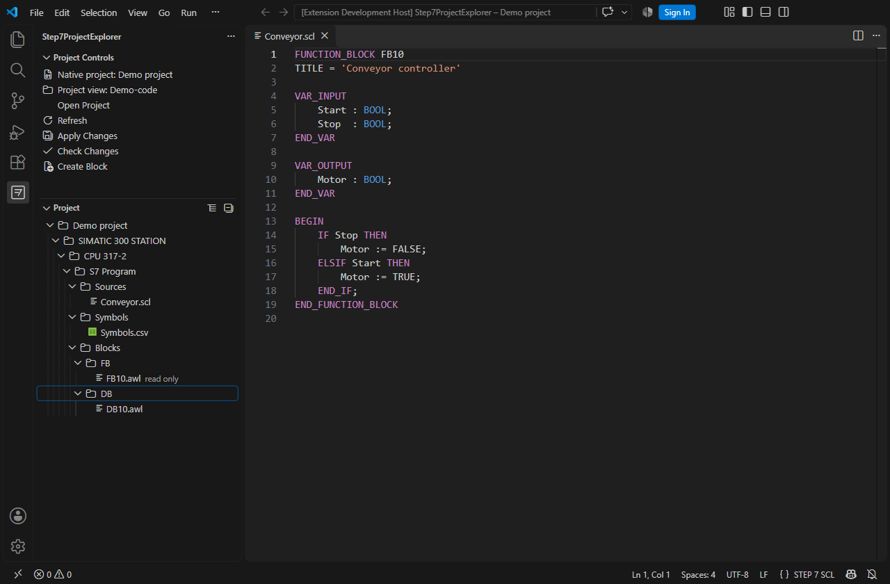

# Step7ProjectExplorer

[English](README.md) | **Русский**

[](https://github.com/Svyatogor3757/vscode-step7-project-explorer/releases/latest)
[](LICENSE)


[Быстрый старт](#быстрый-старт) · [Для ИИ-агентов](docs/AGENT-USAGE.ru.md) · [Релизы](https://github.com/Svyatogor3757/vscode-step7-project-explorer/releases) · [Сообщить об ошибке](https://github.com/Svyatogor3757/vscode-step7-project-explorer/issues)

Step7ProjectExplorer – **плагин VS Code для редактирования кода проектов STEP 7 Classic**. Исходники, блоки и символы доступны в одной рабочей области: можно искать код и ссылки, редактировать несколько файлов и сравнивать изменения через Git.

Плагин создаёт **видовое представление оригинального проекта** – папку с UTF-8-файлами для редактирования обычными инструментами. Правки проверяются на временной копии и записываются в оригинал отдельной командой «Применить изменения».

Эти файлы доступны и **ИИ-агентам для изучения, ревью, создания и доработки кода**. Передайте Codex путь к файлу; проверка правок выполняется через CLI по инструкции в AGENTS.md.

Поддерживаются **Sources, Symbols и Blocks** для **STEP 7 V5.5 SP3 / S7-300 под Windows**, в том числе через **VS Code Remote SSH**. Часть объектов доступна только для чтения. Оборудование, сети, соединения и загрузка в ПЛК остаются в штатных программах Siemens.



Дерево и SCL-редактор на демонстрационном проекте.

## Быстрый старт

Скачайте VSIX из [GitHub Releases](https://github.com/Svyatogor3757/vscode-step7-project-explorer/releases), установите через **Extensions → … → Install from VSIX** и откройте **Step7ProjectExplorer**. Локальный пакет 0.1.5 – `releases/step7project-0.1.5.vsix`. Наш код – под MIT; зависимости сохраняют [собственные лицензии и примечания](THIRD-PARTY-NOTICES.md). После обновления установленного плагина выполните **Developer: Reload Window**.

1. В группе **Управление проектом** нажмите **Открыть проект** и укажите файл оригинального STEP 7-проекта, например `D:\PLC\Plant\Plant.s7p`.
2. Во втором диалоге выберите **папку, в которой будет храниться представление проекта**. Плагин создаст внутри неё каталог `<имя-проекта>-code`. Например, при выборе `D:\Code` получится `D:\Code\Plant-code`. Это папка редактируемого представления, отдельная от оригинального проекта.
3. Откройте файл в **Sources**, **Symbols** или **Blocks**, внесите изменения и сохраните. Объекты только для чтения можно просматривать.
4. Нажмите **Проверить изменения**: плагин скомпилирует правки на временной копии. После проверки используйте **Применить изменения**, чтобы записать их в оригинальный STEP 7-проект. Одно сохранение файла представления оригинальный проект не меняет.

Готовое представление можно подключить по его `step7project.json` без повторного экспорта. Представления внутри открытых папок workspace находятся автоматически. Для нативного импорта и компиляции нужен установленный STEP 7 с лицензией и нужными языковыми пакетами; офлайн-чтение этого не требует.

## Возможности

| Задача | Что доступно |
| --- | --- |
| Просмотр проекта | Дерево Sources, Symbols и Blocks для каждой CPU-программы, переключение между несколькими представлениями. |
| Редактирование кода и данных | Правка поддерживаемых SCL/AWL-исходников и доступных для записи AWL-представлений блоков, DB и UDT. Защищённые и неподдерживаемые объекты остаются только для чтения. |
| Создание и удаление | Шаблоны исходников OB/FC/FB/DB/UDT, включая экземплярные DB; переименование объектов Sources; явное удаление исходников и блоков. |
| Таблица символов | Встроенная таблица, текстовый редактор или сторонний CSV-редактор. Переключение канонического файла между CSV и ASC. |
| Проверка правок | Diff относительно экспортированной версии, компиляция на копии, применение с проверкой конфликтов и повторным экспортом. |
| Обновление из STEP 7 | Перечитывание нативного проекта с сохранением локальных правок и отображением конфликтов. |
| Резервные копии | Настройка периодичности, просмотр предыдущих версий файлов и восстановление снимка в новую папку. |
| Работа через ИИ | Обычные пути к файлам, инструкции и CLI для статуса, проверок, создания, переименования, удаления и применения. |
| Повторное открытие и перенос | Подключение по step7project.json, поиск известных представлений и относительные пути к оригинальному проекту, где это возможно. |
| Язык интерфейса | Автовыбор по VS Code, English/Russian или импорт неполного пользовательского перевода с английским fallback. Название Step7ProjectExplorer не переводится. |
| Remote SSH | Работа расширения и backend на Windows-хосте с STEP 7 и файлами проекта. |


## Интерфейс, активный проект и перенос

Проводник разделён на две стандартные группы VS Code, как «Структура» и «Временная шкала»: **Управление проектом** и **Проект**. Управление содержит пять действий – открыть, обновить, применить, проверить, создать блок. Строки не зависят от переполнения панели заголовка; группы можно сворачивать и менять их высоту.

Если управление скрыто, выполните **Показать управление проектом** из палитры команд или значком в заголовке дерева. Команда раскрывает эту группу, сохраняя расположение других панелей. «Обновить» перечитывает проект STEP 7 и не заменяет перезагрузку окна после установки обновления. О поведении обновлений см. [документацию VS Code](https://code.visualstudio.com/docs/configure/extensions/extension-marketplace#_update-an-extension).

Встроены English и Russian, по умолчанию язык следует Display Language в VS Code. `step7project.interface.language` позволяет отдельно выбрать язык дерева и диалогов. Команда **Выбрать язык интерфейса** также импортирует личные `interface_*.json` без сборки и показывает сохранённые пользовательские переводы. Неполные переводы дополняются стандартными английскими строками. Нативные команды и настройки VS Code следуют языку самой среды; открытую таблицу Symbols после смены языка откройте заново. Диагностика CLI, backend и компиляторов может оставаться на исходном языке. Мнемоника AWL не меняется. Формат и пример файла: [language/README.md](language/README.md).

Выпадающие списки настроек показывают переведённые подписи – «Каждое сохранение», «Таблица», «Относительный, если возможно» и т. п. В JSON настроек остаются прежние значения `everySave`, `table`, `relative`; существующая конфигурация совместима.

Автовыбор учитывает встроенные и сохранённые пользовательские переводы. Если для языка среды нет подходящего перевода, используется английский. Явный выбор пользователя имеет приоритет над автоматическим определением.

При открытии рабочей области расширение ищет `step7project.json` в её корнях и вложенных папках. Резервные копии и служебные каталоги `.git`, `.step7project`, `.scratch`, `node_modules` исключены. Можно держать несколько представлений. Активное выбирается командой **Выбрать активный проект**, переключением редактора на его файл или открытием файла из дерева. Действия управления работают с активным проектом; его выбор сохраняется для рабочей области.

В управлении показаны нативный проект и каталог представления. Подсказки содержат полные пути. Щелчок переключает на «Файлы» в VS Code: существующая содержащая папка переиспользуется, а при нескольких подходящих корнях выбирается наиболее конкретный. Если подходящей папки нет, каталог нативного проекта или представления добавляется в текущий workspace; остальные корни сохраняются. Отсутствующий на диске путь вызывает ошибку без открытия посторонней папки. Правой кнопкой доступны копирование полного/относительного пути и отдельный переход в проводник Windows, для представления – также проводник VS Code.

Удаление папки из workspace закрывает проект в Step7ProjectExplorer, если больше ни один корень не содержит его представление. Это не удаляет файлы. Для повторного подключения выберите `step7project.json` через «Открыть проект». Закрытые проекты не удерживаются автоматически. Временное сохранение перехода при перезапуске Extension Host относится только к уже запрошенному добавлению папки; отменённое добавление или последующее закрытие не восстанавливаются автоматически.

Поле `project` в манифесте указывает на нативный `.s7p`; относительное значение вычисляется **от папки манифеста**, а не от текущего терминала. В новых представлениях настройка `step7project.projectPath.mode` по умолчанию `relative`; между разными дисками сохраняется абсолютный путь. Поэтому нативный проект и представление можно переносить вместе с сохранением взаимного расположения. Путь самого представления внутри JSON не дублируется.

Старые абсолютные привязки не переписываются автоматически. Для существующего представления: `step7project.cmd configure --workspace . --project-path relative` или `absolute`. Это не меняет нативный проект и локальный код. Новые представления и переход на относительную привязку используют schema 2: версия 0.1.0 отклонит такой манифест, вместо неправильного разрешения пути. Старые schema 1 поддерживаются.

Индекс связей «нативный проект → представления» хранится только в пользовательском состоянии расширения на хосте, не в Siemens-проекте и не в Git. Перед повторным подключением проверяется актуальный манифест. После передачи другому пользователю достаточно открыть папку с представлением или его JSON; служебный launcher будет привязан к текущей установке расширения. Пользовательские версии launcher и AGENTS.md сохраняются.

Чтение проекта не требует STEP 7. Для импорта и компиляции нужен установленный STEP 7 с нужными языковыми пакетами и лицензиями, .NET Framework 4.8 и проект, однажды открытый в SIMATIC Manager. Code должен работать с правами пользователя, которому доступен проект. Hardware, NetPro и загрузка в ПЛК выполняются средствами Siemens.

## Remote SSH

Подключитесь VS Code Remote SSH к Windows-машине с STEP 7 и установите расширение **на удалённый хост**. Проект и рабочие файлы остаются там. Для записи войдите в Windows под той же учётной записью: native-компиляторы STEP 7 используют desktop-сеанс. Расширение запускает bridge в нём через временную задачу Планировщика заданий; пароль в настройках не хранится. Чтение и текстовое редактирование доступны без desktop-сеанса.

Расширение объявлено как `extensionKind: workspace`, поэтому backend запускается на том же хосте, что рабочий каталог, согласно [модели Remote Extensions](https://code.visualstudio.com/api/advanced-topics/remote-extensions).

## Что редактируется

| Объект | Представление и запись |
| --- | --- |
| SCL, AWL/STL в Sources | Исходный текст; импорт и компиляция через STEP 7 |
| OB, FC, FB на AWL | Полный экспорт в AWL и обратная компиляция, если блок не защищён |
| DB, UDT | AWL-представление структуры и значений, обратная компиляция |
| Блок, скомпилированный из SCL | Доступное представление только для чтения; меняйте оригинал в Sources |
| LAD/FBD/GRAPH и неизвестные форматы | Только чтение; преобразование графического оригинала в AWL автоматически не выполняется |
| Защищённые блоки, SFC/SFB | Только чтение; доступные метаданные/интерфейс, без обхода защиты |
| Symbols | CSV или ASC; встроенная таблица, текст либо сторонний CSV-редактор |
| VAT | Отображаются как неподдерживаемые для изменения блоки; ссылки VAT в symbols сохраняются |

Команда **Создать блок** создаёт шаблоны OB/FC/FB/DB/UDT на SCL или AWL, включая экземплярные DB. До применения это новые локальные исходники; после компиляции появляются блоки. Номер блока и зависимости окончательно проверяет STEP 7.

Исходник может создавать несколько блоков. Удаление исходника оставляет уже скомпилированные блоки; для их удаления используйте отдельные объекты Blocks. Пропажа файла с диска не удаляет объект автоматически. **Переименовать исходник** задаёт имя объекта Sources, а не функции внутри текста: проверяются 1–24 символа, запрещённые имена Windows и дубликаты в той же программе. До Apply это запланированное изменение. Apply переимпортирует и компилирует исходник через STEP 7 с проверкой stage и повторного экспорта, поэтому нативные таблицы обновляет Siemens.

Имена функций и ссылки внутри исходника автоматически не переименовываются. Нельзя переименовать DB117.awl в другой номер обычной файловой операцией: номер DB и символьное имя – разные вещи. Символьное имя задаётся строкой Symbols с адресом DB117; изменение номера требует создания нового блока, обновления всех ссылок, проверки и отдельного удаления старого. Автоматический глобальный рефакторинг таких связей не реализован.

`step7project.awl.mnemonics` выбирает английскую (`A`, `JU`) или немецкую (`U`, `SPA`) мнемонику для нового рабочего каталога. Она должна соответствовать **Options → Customize → Language** в STEP 7. Настройка сохраняется в манифесте; для существующего каталога без локальных правок выполните CLI `configure --workspace . --mnemonics english` (или `german`), затем `refresh --workspace .`. Исходные тексты автоматически не переводятся. Для CSL отдельный компилятор не реализован: поддержаны штатные SCL и AWL/STL.

Незащищённые пользовательские блоки, включая скомпилированные из SCL, можно явно удалять; возможность удаления не означает доступности редактирования текста. Изменение интерфейса FB/UDT может потребовать обновления зависимых блоков и экземплярных DB. Автоматическое пересоздание всех зависимостей не выполняется; проверяйте согласованность средствами STEP 7.

## Symbols и резервирование

`step7project.symbols.editor`: `table` – встроенная таблица, `text` – текстовый редактор, `default` – редактор по умолчанию, включая сторонний CSV-плагин. Команда **Open as Text** доступна и в контекстном меню.

`step7project.symbols.format` задаёт CSV/ASC для новых рабочих каталогов. Новые файлы называются `Symbols.csv` или `Symbols.asc` внутри папки Symbols. Для существующего используйте **Выбрать формат Symbols** без неприменённых правок таблицы. Старые `Symbols.symbols.csv` поддерживаются: закройте редакторы Symbols и повторно выберите текущий формат, чтобы сократить имя. При конфликте с существующим целевым файлом операция отклоняется. Канонический файл один: независимые CSV и ASC одновременно не редактируются.

`step7project.backup.mode`:

| Значение | Режим |
| --- | --- |
| `off` | Выключено |
| `everySave` | Каждое наблюдаемое сохранение, по умолчанию |
| `1m` | Каждую минуту |
| `10m` | Каждые 10 минут |
| `30m` | Каждые 30 минут |
| `1h` | Каждый час |

Сохраняются предыдущие версии изменённых файлов, включая изменения внешними инструментами/ИИ при активном расширении. Быстрые внешние записи watcher может объединить; закрытый VS Code не ведёт историю внешних сохранений. В каждом включённом режиме перед применением создаётся снимок нативного проекта. Выключенный режим не создаёт постоянных автоматических копий.

`step7project.backup.directory` задаёт каталог; по умолчанию `.step7project/backups` в рабочем каталоге. Снимки не удаляются автоматически. **Restore Backup to New Folder** восстанавливает копию в новый путь, не поверх открытого проекта.

CSV/ASC содержит имя, адрес, тип и комментарий. Если нативная таблица использует дополнительные атрибуты, которые этот формат не сохраняет (например, WinCC), таблица открывается только для чтения с причиной в `status`. Незавершённые строки можно читать; перед применением нужно заполнить обязательные поля. Неизвестные символы не удаляются автоматически.

## Работа ИИ

Новые экспортируемые инструкции для агентов создаются на английском; существующий пользовательский AGENTS.md сохраняется. Подробное руководство: [Русский](docs/AGENT-USAGE.ru.md) / [English](docs/AGENT-USAGE.md).

Каждый экспортированный каталог получает `AGENTS.md` и `step7project.cmd`. Существующий AGENTS.md сохраняется. В исходном репозитории инструкция находится в [AGENTS.md](AGENTS.md), подробные команды – в [docs/AGENT-USAGE.md](docs/AGENT-USAGE.md).

```powershell
.\step7project.cmd status --workspace . --json
.\step7project.cmd check --workspace . --json
.\step7project.cmd apply --workspace . --json
```

Манифест `step7project.json` связывает файлы с точными программами и объектами. Служебные базовые версии и резервные копии хранятся в `.step7project`. Сохранение не означает импорт; агент должен отдельно сообщать результат проверки и применения.

## Надёжность применения

Перед записью плагин проверяет изменения объектов всей затронутой программы, компилирует отдельную COM-копию программы в TEMP-проекте, затем повторяет проверку исходного проекта. Предварительная компиляция использует штатный `S7Program.Copy`; бинарные таблицы проекта не редактируются. После применения результат повторно экспортируется и сравнивается со staging.

Нативный COM API не обеспечивает общую транзакцию нескольких импортов. При ошибке во время записи плагин сохраняет правки и устанавливает `recovery`, который блокирует дальнейшие применения до проверки оператором. Автоматического отката поверх открытого проекта нет. Состояния и порядок восстановления описаны в инструкции для агентов.

Не меняйте одновременно одну программу в SIMATIC Manager и через плагин. Блокировка Step7ProjectExplorer защищает от другого экземпляра нашего инструмента; она не блокирует редакторы Siemens. Тестовые проекты и журналы остаются в `%TEMP%` для диагностики.

## Сборка и проверка

Порядок тегирования, CI и черновиков GitHub Releases описан в [docs/RELEASING.md](docs/RELEASING.md). Локальная упаковка разрешена с сохранением сведений о лицензиях; публикация выполняется отдельно.

Исходники используемой Toolbox 4.4.10 закреплены в Git-подмодуле `third-party/sources/Toolbox`. Для исследования и последующей работы выполните `git submodule update --init --recursive`. [Лицензии по частям и их нюансы](third-party/Toolbox.COMPONENTS.md). Обычная сборка backend пока использует неизменённый NuGet-пакет той же версии.

Требуются Node.js 20+, npm, актуальный .NET SDK с поддержкой сборки `net48`. Reference assemblies восстанавливаются через NuGet; установленный STEP 7 для самой сборки не нужен.

```powershell
npm ci
npm run build:backend
npm test
npm run licenses:audit
npm run package
```

Упаковка выполняет `licenses:audit`: несоответствия технического инвентаря останавливают сборку, а открытые лицензионные вопросы выводятся и сохраняются. `licenses:check` остаётся отдельной строгой проверкой готовности к распространению. Локальный VSIX не меняет лицензии зависимостей и не закрывает эти вопросы. Подробнее: [docs/LICENSING.md](docs/LICENSING.md).

Backend собирается как **x86**, поскольку STEP 7 V5.x Command Interface использует 32-битный интерфейс; см. [Siemens README V5.5 SP4, Command Interface](https://support.industry.siemens.com/cs/attachments/93842005/README.pdf). Основная целевая проверка этого проекта – V5.5 SP3, а не TIA Openness.

Для отладки нажмите F5 – конфигурация Extension Host находится в `.vscode/launch.json`. VM-проверки запускаются `node tools/deploy-test.cjs`, затем `node tools/run-integration.cjs`; они требуют разрешённого SSH alias `vmware-siemens` и создают новые проекты только в TEMP. Не запускайте их на рабочем проекте.

Сведения о реально выполненных проверках и ограничениях: [docs/VERIFICATION.md](docs/VERIFICATION.md). Устройство backend и первичные источники: [docs/BACKEND.md](docs/BACKEND.md). История изменений: [CHANGELOG.ru.md](CHANGELOG.ru.md).

## Структура репозитория

`src` – расширение и CLI, `backend` – x86 COM bridge и офлайн-чтение, `test` – автоматические тесты, `tools` – диагностические и VM-сценарии, `docs` – инструкции. Пользовательские примеры исключены из Git и VSIX. Результаты сборки также не коммитятся; VSIX включает собранные JS и backend-бинарники.

`language/interface_*.json` – исходники переводов, `releases/` – результаты упаковки. `npm run package` создаёт каталог и после проверок записывает туда `step7project-<версия>.vsix`.

Корневые JSON-файлы выполняют разные задачи:

| Файл | Назначение |
| --- | --- |
| `package.json` | Обязательный манифест расширения: команды, настройки, сборка и заявленные зависимости. Генератор обновляет в нём список встроенных языков и подписи вариантов настроек. |
| `package-lock.json` | Точные версии и контрольные суммы полного дерева npm-зависимостей для воспроизводимого `npm ci`. Это не копия манифеста. |
| `package.nls.json`, `package.nls.ru.json` | Сгенерированные словари для команд и настроек, которые читает сам VS Code. Имена и расположение определяются его форматом; редактируемые переводы находятся в `language/`. |

## Лицензия

Оригинальный код Step7ProjectExplorer распространяется по [лицензии MIT](LICENSE). Автор – **Cody** ([Svyatogor3757](https://github.com/Svyatogor3757)). При распространении копий или существенных частей кода сохраняйте copyright и полный текст лицензии.

Сторонние компоненты сохраняют собственные лицензии и авторство: [THIRD-PARTY-NOTICES.md](THIRD-PARTY-NOTICES.md). Условия поставки и известные нюансы описаны в [docs/LICENSING.md](docs/LICENSING.md).

## Disclaimer / Товарные знаки и независимость проекта

Siemens, SIMATIC и STEP 7 – товарные знаки Siemens AG или её аффилированных компаний. Эти названия используются в проекте исключительно для обозначения совместимости с соответствующими продуктами и технологиями.

Step7ProjectExplorer – независимый проект. Он не связан с Siemens AG, не спонсируется, не одобряется и официально не поддерживается этой компанией. Все права на упомянутые товарные знаки принадлежат соответствующим правообладателям.

Siemens, SIMATIC and STEP 7 are trademarks of Siemens AG or its affiliates. These names are used solely to identify compatibility with their respective products and technologies. Step7ProjectExplorer is an independent project and is not affiliated with, sponsored by, endorsed by, or officially supported by Siemens AG. All trademark rights remain with their respective owners.
